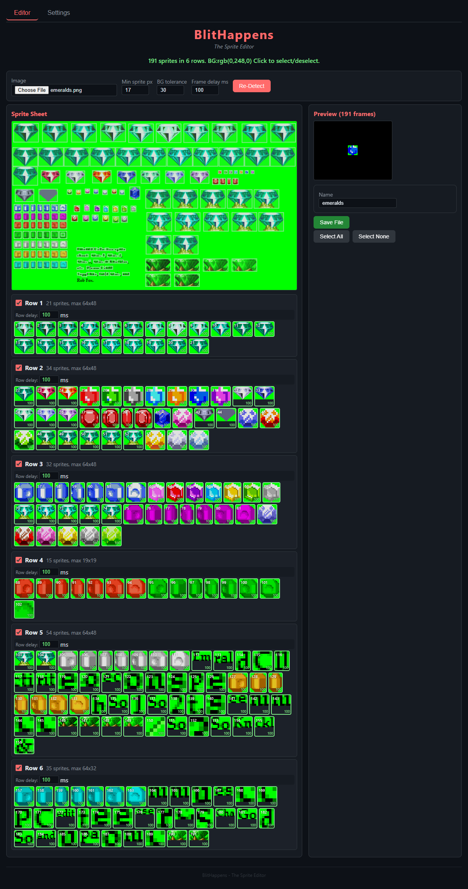
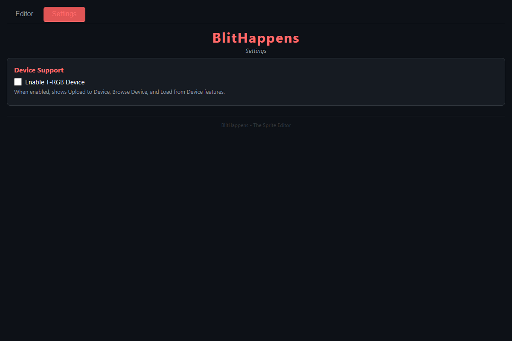
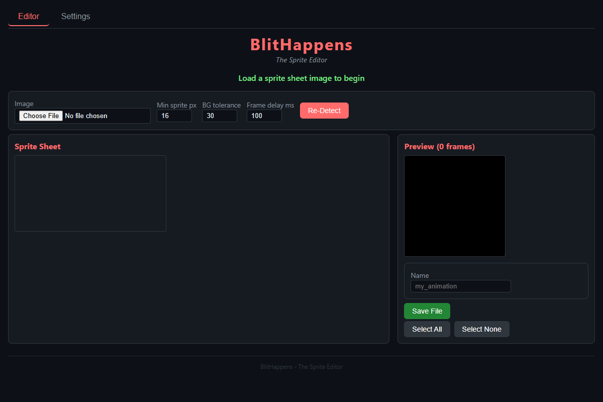

# BlitHappens

Browser-based sprite sheet editor. Load any sprite sheet image, auto-detect individual sprites, preview animations with per-frame timing, and export as binary or upload directly to a T-RGB device.

No server required — open `index.html` in any modern browser.

## Quick Start

1. Open `index.html` in Chrome, Firefox, or Edge
2. Click **Choose File** and select a sprite sheet image
3. Sprites are auto-detected with background removal
4. Click sprites or rows to select what you want
5. Set frame delay per row
6. Click **Save File** to download the `.sprbin` binary

*191 sprites detected across 6 rows, with selection highlighting and live preview*

## Features

- **Auto-detect sprites** from any image (PNG, JPG, WebP)
- **Smart background removal** — edge histogram sampling detects the background color, not just corner pixel
- **Connected component detection** — flood fill finds contiguous sprite regions
- **Row-based grouping** — each row of sprites becomes a separate animation
- **Per-row frame delay** — set timing independently per animation row
- **Live animation preview** with per-frame timing
- **Click to select/deselect** individual sprites or entire rows
- **Auto min-px calibration** — adapts to image dimensions
- **Text/noise filter** — rejects extreme aspect ratio tiny regions

## Export

- **Save File** — downloads a `.sprbin` binary (RGB565+A8 format, 3 bytes/pixel)
- **Upload to Device** — send directly to a T-RGB device over WiFi (optional, see Settings)

## Device Integration (Optional)

BlitHappens can optionally connect to a T-RGB-Player device for direct upload and browsing over WiFi.

1. Open the **Settings** tab
2. Check **Enable T-RGB Device**
3. Enter the device's IP address (shown on device serial console via `WIFISTATUS`)
4. Click **Test Connection** to verify

When enabled:
- **Upload to Device** button appears in the editor — sends the selected sprites directly to the device
- **Browse Device** lists existing animations on the device's SD card
- **Load from Device** loads an existing animation back into the editor for re-editing

Device IP is stored in browser localStorage and persists across sessions. All device communication uses standard HTTP (no plugins or extensions needed).

## Binary Format (.sprbin)

All frames concatenated, each pixel stored as 3 bytes:

| Byte | Content |
|------|---------|
| 0-1 | RGB565 color (little-endian) |
| 2 | Alpha (0x00 = transparent, 0xFF = opaque) |

Accompanied by a `.meta` text file: `frame_width frame_height num_frames delay_ms`

Sprites larger than 478px are downscaled before export.

## Editor Layout

The editor has two panels:
- **Left** — Sprite sheet canvas with detection overlay (green = selected, red outline = deselected). Below: row list with per-row delay controls and sprite thumbnails.
- **Right** — Live animation preview, name input, Save/Upload buttons, Select All/None.

The **toolbar** at top controls detection parameters:
- **Min sprite px** — minimum size to detect (auto-calibrated on load)
- **BG tolerance** — how aggressively to remove the background color (default 30)
- **Frame delay ms** — default timing for new detections
- **Re-Detect** — rerun detection with current settings

## Files

| File | Purpose |
|------|---------|
| `index.html` | Page structure, Editor and Settings tabs |
| `style.css` | Dark theme styling |
| `editor.js` | All logic: detection, selection, preview, export, device communication |

## License

MIT License. See [LICENSE](LICENSE).